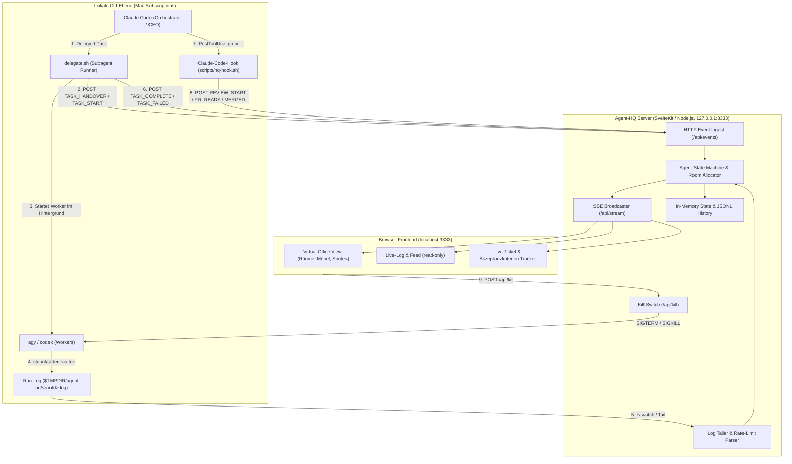
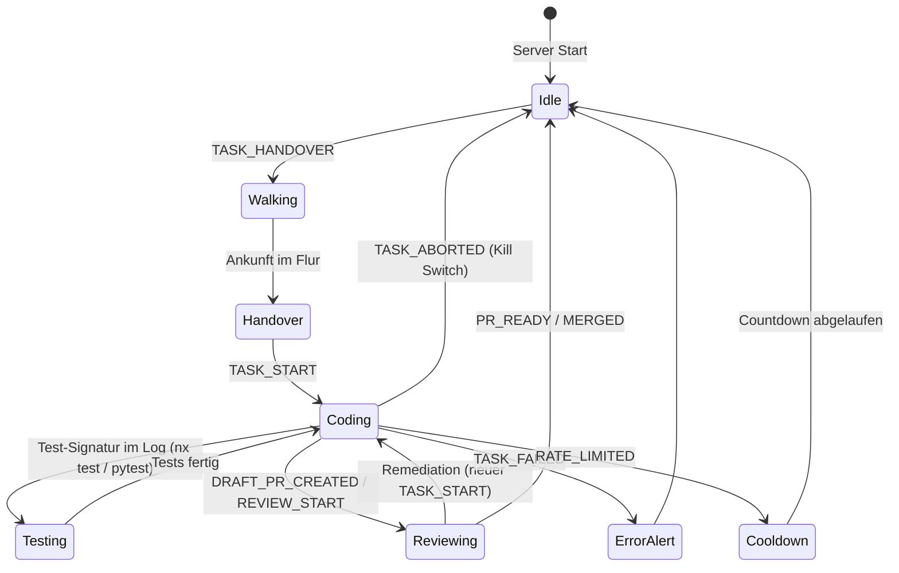
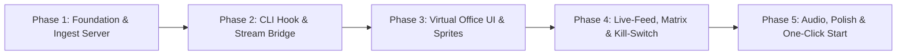

# Project Plan: Agent-HQ (Virtual Office & Multi-Agent Monitor)

## 1. Executive Summary & Vision

**Agent-HQ** ist ein leichtgewichtiges, lokales Monitoring- und Visualisierungs-Dashboard für das Multi-Agenten-Ökosystem bestehend aus dem **Lead Architect (Claude Code)** und spezialisierten **Subagents (`agy` / Antigravity, `codex`)**.

Ziel ist es, den Fortschritt, Übergaben, Denkprozesse und Reviews der Agenten in Echtzeit visuell greifbar zu machen – in Form eines interaktiven **2D-Retro-Büros („Virtual Office“)** mit animierten **16-Bit Pixel-Art Charakteren** (SNES/Mega-Drive-Ästhetik) und einer konsolidierten **Live-Log-Zentrale**.

### Kernprinzipien & Restriktionen

1. **100 % API-Key-frei**: Keine externen LLM-API-Aufrufe, keine Token-Abrechnung. Das Monitoring greift rein auf die bereits vorhandenen lokalen CLI-Tools und bestehenden Flatrate-/Pro-Abonnements (`claude`, `agy`, `codex`) zu.
2. **Rein CLI-gestützt**: Die Status-Erfassung erfolgt über Events aus `delegate.sh`, Claude-Code-Hooks und lokales Log-Tailing.
3. **Ponytail & Zero Boilershit**: Schlanke, native Webtechnologien (SvelteKit + TailwindCSS + SSE), kein überdimensionierter Enterprise-Überbau.
4. **Rein lokal**: Der Server bindet ausschließlich an `127.0.0.1`.

> [!NOTE]
> Die genaue Arbeitsweise, Rollenteilung und der 7-Schritte-Delegations-Workflow des Orchestrators sind im Konzeptdokument [orchestrator-skill.md](docs/concepts/orchestrator-skill.md) detailliert beschrieben.

---

## 2. Architektur & Systemüberblick



---

## 3. Die Räume & Charakter-Mechanik

Das Büro ist in visuelle Funktionszonen (Räume) unterteilt. Jede Figur besitzt einen aktuellen Zustand und bewegt sich dynamisch zwischen den Räumen.

### Visueller Stil: 16-Bit Pixel-Art Ästhetik

- **Retro 16-Bit Look**: Inspiriert von klassischen 16-Bit SNES/Mega-Drive-RPGs (z.B. Chrono Trigger / Earthbound) oder Habbo/Kairosoft-Spielen.
- **Pixel Grid**: Basis-Sprites in 32x32 oder 48x48 Pixeln, knackscharf skaliert mittels `image-rendering: pixelated;`.
- **Individuelle 16-Bit Charakter-Designs**:
  - 👔 **Claude (CEO / Lead Architect)**: Senior-Look, Sakko/Krawatte, Notiz-Klemmbrett, nachdenklicher Blick.
  - 💻 **`agy` (Core Developer)**: Lässiger Dev mit Hoodie, mechanischer Tastatur und Energy-Drink.
  - 🤖 **`codex` (Algorithm Specialist / Reviewer)**: Futuristischer / fokussierter Charakter mit Brille und Terminal-Glow.

### Die Räume

Fünf Zonen, im Event-Schema als `room` kodiert:

| Raum                                | `room`   | Primäre Agenten     | Auslöser / Aktivität                                     | Visuelle Raum-Elemente                                   |
| :---------------------------------- | :------- | :------------------ | :------------------------------------------------------- | :------------------------------------------------------- |
| 👔 **CEO Suite / Architect Office** | `ceo`    | **Claude**          | Ticket-Erstellung, Architektur-Planung, Scope-Definition | Großer Schreibtisch, Architektur-Whiteboard, Bücherregal |
| 🚪 **Flur & Übergabezone**          | `hall`   | **Claude ➔ Worker** | Moment der Task-Delegation (`delegate.sh`)               | Verbindender Gang zwischen den Büros                     |
| 💻 **Dev Lab (Entwickler)**         | `dev`    | **`agy` / `codex`** | Code-Generierung, Refactoring, Datei-Edits               | Monitore mit Matrix-Code, Workstations, Kaffeetassen     |
| 🔍 **QS & Review Station**          | `qa`     | **Claude / CI**     | Prüfen von Akzeptanzkriterien, Test-Runs, PR-Review      | Test-Server-Racks, Monitor mit grünen/roten Checkmarks   |
| ☕ **Lounge / Breakroom**           | `lounge` | **Alle Idler**      | Kein aktiver Task, Wartet auf User-Input, Cooldown       | Couch, Kaffeemaschine, Wasserspender, Pflanze            |

### Charakter-Zustände & Animationen



- **`idle`**: Figur sitzt in der Lounge, nippt an Kaffeetasse, schläft mit „Zzz“ oder liest Zeitung.
- **`walking`**: Figur läuft animiert von Raum A nach Raum B (Waypoints entlang des Flurs).
- **`handover`**: Claude übergibt `agy` eine gelbe Ticket-Akte (kurze Übergabe-Animation).
- **`coding`**: Figur sitzt am Rechner und hackt auf der Tastatur (Bildschirm leuchtet).
- **`testing`**: Fortschrittsbalken oder rotierendes Rädchen über dem Kopf.
- **`reviewing`**: Claude steht mit Lupe / Notizblock vor der Akte und hakt Kriterien ab.
- **`cooldown`**: Figur liegt mit Schlafmütze in der Lounge, Countdown über dem Kopf.

### 16-Bit Sprite-Sheet & Frame-Spezifikation

- **Sprite-Auflösung**: 32x32 oder 48x48 Pixel Base Frames, gerendert mit CSS `image-rendering: pixelated;`.
- **Frames pro Charakter**:
  - `idle_frames`: 2–4 Frames Loop (Subtiles Wippen, Blinzeln, Kaffeetasse heben).
  - `walk_frames`: 4-Richtungs-Walkcycle (je 4 Frames für oben, unten, links, rechts).
  - `typing_frames`: 3 Frames Tastatur-Hacken mit Bildschirm-Flimmern.
  - `handover_frames`: 2 Frames Ausstrecken und Übergeben der Ticket-Akte.
  - `review_frames`: 2 Frames Kopfschütteln / Haken ins Klemmbrett setzen.
- **Palette & Styling**: Authentische 16-Bit Farbpalette (z.B. PICO-8 / Endesga 32 oder klassische SNES 16-Farben-Shader).

---

## 4. CLI Integration & Event-Protokoll (100 % API-Key-frei)

Die Statusübertragung funktioniert ohne Backend-Tokens rein über Standard-UNIX-Mechanismen und HTTP-POST-Calls. Es gibt drei Event-Quellen:

| Quelle                                  | Events                                                                                     |
| :-------------------------------------- | :----------------------------------------------------------------------------------------- |
| `delegate.sh`                           | `TASK_HANDOVER`, `TASK_START`, `TASK_COMPLETE`, `TASK_FAILED`                              |
| Claude-Code-Hook (`scripts/hq-hook.sh`) | `DRAFT_PR_CREATED`, `REVIEW_START`, `PR_READY`, `CI_CHECK_PASS`, `CI_CHECK_FAIL`, `MERGED` |
| Server (intern)                         | `TASK_PROGRESS` (Log-Tail), `RATE_LIMITED` (Log-Parser), `TASK_ABORTED` (Kill Switch)      |

### A. Schnittstelle in `delegate.sh`

Der Worker läuft als Hintergrundprozess, damit `delegate.sh` (a) die echte Worker-PID für den Kill Switch kennt und (b) nach Prozessende noch `TASK_COMPLETE`/`TASK_FAILED` mit Exit-Code senden kann.

> [!IMPORTANT]
> Kein `exec ... | tee`: In einer Pipeline läuft jeder Teil in einer eigenen Subshell, `exec` ersetzt dann nicht die Skript-PID. `$$` würde auf die Shell zeigen und ein Kill ließe `agy` verwaist weiterlaufen. Die Ausgabe wird deshalb per Process Substitution umgeleitet, die PID kommt aus `$!`.

Jeder Lauf schreibt in eine eigene Log-Datei (`$TMPDIR/agent-hq/<runId>.log`), damit parallele Läufe sich nicht überschreiben. Die vollständige Referenzimplementierung steht im [Konzeptdokument, Abschnitt 4B](docs/concepts/orchestrator-skill.md).

```bash
"${CMD[@]}" > >(tee "$LOG") 2>&1 &
PID=$!
hq_event TASK_START "$PID"
wait "$PID"; CODE=$?
hq_event "$([ $CODE -eq 0 ] && echo TASK_COMPLETE || echo TASK_FAILED)" "$PID" "$CODE"
```

### B. Claude-Code-Hook für Orchestrator-Events

Events aus Claudes eigenen Schritten (Review, Ready, Merge) kann `delegate.sh` nicht senden. Dafür wird ein `PostToolUse`-Hook mit Matcher `Bash` in `~/.claude/settings.json` registriert. `scripts/hq-hook.sh` liest das Hook-JSON von stdin, prüft `tool_input.command` und sendet das passende Event:

| Kommando-Muster               | Event                             |
| :---------------------------- | :-------------------------------- |
| `gh pr create --draft`        | `DRAFT_PR_CREATED`                |
| `gh pr diff` / `gh pr view`   | `REVIEW_START`                    |
| `gh pr ready`                 | `PR_READY`                        |
| `gh pr checks` (Exit 0 / ≠ 0) | `CI_CHECK_PASS` / `CI_CHECK_FAIL` |
| `gh pr merge`                 | `MERGED`                          |

Der Hook ist ebenso fehlertolerant wie `delegate.sh` (siehe 6D) und gibt immer Exit 0 zurück.

### C. Standardisiertes Event-JSON-Schema

```json
{
  "timestamp": "2026-10-22T16:40:00.000Z",
  "event": "TASK_HANDOVER | TASK_START | TASK_PROGRESS | TASK_COMPLETE | TASK_FAILED | TASK_ABORTED | DRAFT_PR_CREATED | REVIEW_START | PR_READY | CI_CHECK_PASS | CI_CHECK_FAIL | MERGED | RATE_LIMITED",
  "agent": "claude | agy | codex",
  "room": "ceo | hall | dev | qa | lounge",
  "runId": "1761150000-4242",
  "ticketId": "12",
  "pid": 4243,
  "cwd": "/Users/.../repo/.worktrees/feat-12-login",
  "data": {
    "title": "Implement login service",
    "statusText": "Running unit tests...",
    "exitCode": 0,
    "logFile": "/var/folders/.../agent-hq/1761150000-4242.log",
    "prNumber": 34,
    "criteriaTotal": 4,
    "criteriaCompleted": 3,
    "cooldownUntil": "2026-10-22T17:02:00.000Z",
    "logChunk": "PASS libs/auth/src/login.spec.ts"
  }
}
```

- `room` ist optional; fehlt es, leitet die State Machine den Raum aus dem Event ab.
- `ticketId` stammt aus der Env-Variable `TICKET_ID` oder wird aus dem Prompt extrahiert (`#12` bzw. `T-01`).
- Alle `data`-Felder sind optional und eventabhängig.

---

## 5. UI-Komponenten im Detail

1. **Top Bar**:
   - Aktives Projekt / Repository (`matze_health_coach`, etc.) mit Branch-Badge
   - Gesamtstatus (z.B. `● Subagent 'agy' working on #12`)
   - 🚨 **Notfall-Stopp („Kill Switch“)**: Sofortiger Abbruch des laufenden Subagents
   - 🔊 **Audio-Toggle**: Stummschalten von Chiptune-Soundeffekten
2. **Zentralbereich: Virtual Office (16-Bit Pixel-Art Floorplan)**:
   - 5 Zonen (4 Räume + Flur) mit 16-Bit Pixel-Tilesets (Teppiche, Schreibtische, Server-Racks, Couch).
   - Scharfe Pixel-Darstellung (`image-rendering: pixelated; crisp-edges`).
   - Frei animierte 16-Bit Sprite-Charaktere (Claude, agy, codex).
   - Status- & Cooldown-Sprechblasen im 16-Bit Retro-Stil (z.B. `Testing...`, `Reviewing #12`, `Rate-Limit Zzz (22m)`).
3. **Rechte Seitenleiste: Live-Feed (read-only)**:
   - **Live Stream**: Synchronisierter Verlauf aller Events, Agenten-Ausgaben, Compiler-Fehler und Test-Outputs.
   - **Farbcodierte Badges & Filter**: `[CLAUDE]`, `[AGY]`, `[CODEX]`, `[TEST]`, `[GIT]`.
   - **Rückfrage-Hinweis**: Erkennt der Log-Parser eine wartende Eingabeaufforderung, erscheint eine hervorgehobene Karte („Agent wartet auf Eingabe → Terminal“) plus Browser-Notification.
   - Eine Eingabezeile (2-Wege-Chat) kommt nur, wenn der Spike aus Abschnitt 6H positiv ausfällt.
4. **Untere Leiste: Ticket & Acceptance Criteria Matrix**:
   - Live-Checkliste der Akzeptanzkriterien des aktuellen Tickets.
   - Haken setzen sich live grün, sobald Claude sie im Review validiert hat.
   - PR-Status-Badge (`Draft` ➔ `Ready` ➔ `Merged`).

---

## 6. Advanced Operations & Safety (Praxis- & Betriebsfunktionen)

Um den Alltag mit lokalen Subagents stabil, transparent und nervenschonend zu gestalten, integriert das System folgende Sicherheits- und Komfortfunktionen:

### A. Der Notfall-Stopp („Kill Switch“) 🚨

- **Problem**: Ein Subagent gerät in eine Endlosschleife, editiert falsche Dateien oder verrennt sich.
- **Mechanismus**:
  - `delegate.sh` meldet mit `TASK_START` die echte Worker-PID (`$!`, siehe 4A). Der Server registriert sie pro `runId`.
  - In der UI existiert ein prominenter **Notfall-Stopp-Button** (auch per Tastenkürzel `Esc`).
  - Klick sendet `POST /api/kill { "runId": "..." }`. Der Server beendet zuerst die Kindprozesse des Workers (`pkill -TERM -P <pid>`, z.B. laufende Test-Runner), dann den Worker selbst per `SIGTERM`; Fallback nach 1.5s: `SIGKILL`. Status wird `TASK_ABORTED`.
  - `delegate.sh` bemerkt das Ende über `wait` und kehrt mit Exit-Code ≠ 0 zurück – Claude sieht den Abbruch im Terminal.
- **Absicherung**:
  - `/api/kill` beendet ausschließlich PIDs, die der Server selbst über `TASK_START` registriert hat – nie beliebige PIDs aus dem Request.
  - Server bindet nur an `127.0.0.1`; POST-Endpoints prüfen den `Origin`-Header (Schutz vor Cross-Site-Requests aus fremden Browser-Tabs).

### B. 16-Bit Chiptune Sound-FX & Web-Notifications 🔔

- **Audio-Feedback (16-Bit Retro-Sounds, stummschaltbar)**:
  - 🎶 _Success / Level-Up_: Ticket abgeschlossen, PR auf `Ready` geschaltet.
  - 🚪 _Doorbell / Swoosh_: Claude delegiert einen neuen Task an den Subagent.
  - ⚠️ _Buzzer / Glitch_: Testsuite fehlgeschlagen, `TASK_FAILED` oder `CI_CHECK_FAIL`.
- **Browser-Push-Notifications**:
  - Benachrichtigung, wenn **menschliche Interaktion erforderlich ist** (z.B. _"PR #4 bereit für manuellen Merge – keine Pipeline konfiguriert"_, _"Agent wartet auf Eingabe"_ oder _"Review erfordert Architekten-Entscheidung"_).

### C. Rate-Limit & Cooldown-Visualisierung ⏳

- **Erkennung**: Der Log-Tailer des Servers sucht im Run-Log nach bekannten Quota-/Rate-Limit-Signaturen der Flatrate-Abos (Claude CLI 429, Gemini/Antigravity Quota Reset) und erzeugt intern `RATE_LIMITED` mit `cooldownUntil`.
- **Visualisierung**:
  - Die Figur legt sich mit Schlafmütze in die Lounge (`Zzz`).
  - Über dem Kopf erscheint ein Live-Countdown (z.B. `Cooldown: Noch 18 Min bis Quota-Reset`).
  - Verhindert das Rätselraten, warum ein Agent pausiert.

### D. Graceful Degradation (Offline-Resilience) 🛡️

- **Problem**: Der Terminal-Workflow darf **niemals** abbrechen oder hängenbleiben, falls `agent-hq` nicht gestartet ist oder hängt.
- **Mechanismus**: Alle HTTP-Aufrufe in `delegate.sh` und `hq-hook.sh` nutzen ein kurzes Verbindungs- **und** Gesamt-Timeout plus Fehlertoleranz:
  ```bash
  curl --connect-timeout 0.1 --max-time 0.5 -s -X POST "$AGENT_HQ_URL/api/events" ... >/dev/null 2>&1 || true
  ```
  `--connect-timeout` allein reicht nicht: Nimmt ein hängender Server die Verbindung an, ohne zu antworten, würde curl sonst unbegrenzt warten. Läuft der Server nicht, führt `delegate.sh` den Subagent wie gewohnt im Terminal aus.

### E. Multi-Repository & Worktree Auto-Discovery 📂

- Das Event übermittelt das aktuelle Arbeitsverzeichnis (`cwd`).
- Der Server ermittelt daraus Repository (`git rev-parse --show-toplevel`, bei Worktrees via `--git-common-dir`) und aktiven Feature-Branch und passt die Anzeige dynamisch an.

### F. Lokale Session-Historie 📜

- Jedes Event wird an `~/.agent-hq/history.jsonl` angehängt (append-only, kein SQLite – für die Datenmenge reicht JSONL).
- Die UI zeigt die letzten 20 Läufe (gruppiert nach `runId`) inklusive Event-Verlauf, Exit-Code und Link auf das Run-Log.
- Diff-Ansicht pro Lauf: Link auf den PR (`gh pr view --web`) statt eigenem Diff-Viewer.

### G. State Snapshot & Re-Connect Resilience (F5-Sicherheit) 🔄

- **Problem**: Wird der Browser aktualisiert (`F5`) oder neu geöffnet, darf das virtuelle Büro nicht leer sein oder den aktuellen Zustand vergessen.
- **Mechanismus**:
  - Der Server hält den aktuellen Gesamtzustand (`activeAgents`, `currentRooms`, `runningTasks`, `recentLogs`, `activePR`) im In-Memory State.
  - Sobald ein Client eine SSE-Verbindung (`/api/stream`) öffnet, sendet der Server unmittelbar als erstes Event einen `INIT_STATE`-Snapshot.
  - Das Büro baut sich sofort im exakten Ist-Zustand auf, ohne dass auf das nächste CLI-Event gewartet werden muss.

### H. Bidirektionaler Chat („Intercom“) – nur nach erfolgreichem Spike 💬

- **Ausgangslage**: `agy -p` und `codex exec` laufen im nicht-interaktiven Headless-Modus; mit `--dangerously-skip-permissions` entstehen keine `[y/n]`-Abfragen. Der Worker wird zudem über Claudes Bash-Tool ohne TTY gestartet. Eine Injektion in stdin (Named Pipe) hat daher keinen Empfänger.
- **MVP**: Der Live-Feed ist read-only. Erkannte Rückfragen werden nur angezeigt und per Notification gemeldet (siehe 5.3).
- **Spike (Phase 4, time-boxed)**: Klären, ob `agy` / `codex` in einem interaktiven Modus über ein vom Server verwaltetes PTY (`node-pty`) gesteuert werden können, ohne den Delegations-Workflow über Claude zu brechen.
  - **Positiv** ➔ Chat-Eingabe, Quick-Reply-Karten und `POST /api/chat/send` werden als eigenes Ticket umgesetzt.
  - **Negativ** ➔ Feature entfällt; Korrekturen laufen weiter über Kill Switch + erneute Delegation durch Claude.
- **Ergebnis (22.10.2026)**: No-Go, siehe [ADR 0005](docs/adr/0005-kein-pty-chat-korrektur-per-resume.md). Stattdessen „Unterbrechen & nachsteuern“: Kill Switch mit Zusatzanweisung, `delegate.sh` setzt dieselbe Session headless fort (`codex exec resume` / `agy --conversation`), umgesetzt in #35.

---

## 7. Phasenplan & Meilensteine



### Phase 1: Foundation & Ingest Server

- Initialisierung per `repo-init` als **Nx Workspace** mit SvelteKit-App `apps/agent-hq` & **TailwindCSS** (inkl. `docs/adr`, `docs/arc42`, `docs/development`).
- Setup der Ingest-API (`/api/events`, `/api/stream`, `/api/kill`), Bind an `127.0.0.1`, `Origin`-Prüfung.
- Server-Sent Events (SSE) Hub inkl. `INIT_STATE`-Snapshot.
- State Machine für Agents, Runs, PIDs & Räume gemäß Event-Schema (4C).
- Append-only Event-Historie in `~/.agent-hq/history.jsonl`.

### Phase 2: CLI Hook & Stream Bridge

- Umbau von `delegate.sh` gemäß 4A (Hintergrund-Worker, echte PID, Run-Log pro `runId`, `TASK_COMPLETE`/`TASK_FAILED` mit Exit-Code).
- `scripts/hq-hook.sh` + `PostToolUse`-Registrierung für Claudes `gh pr`-Events (4B).
- Log-Tailer im Server (`fs.watch` auf `$TMPDIR/agent-hq/`), inkl. Erkennung neuer Run-Logs.
- Fallback-Test: Dashboard aus bzw. hängend ➔ `delegate.sh` und Hook laufen ohne Verzögerung > 0.5s weiter.

### Phase 3: Virtual Office UI & 16-Bit Sprite Engine

- Aufbau des 2D-Grundrisses mit 16-Bit Pixel-Art Tilesets (CEO-Office, Flur, Dev-Lab, QS-Station, Lounge).
- CSS-Sprite- & Canvas-Renderer für 16-Bit Pixel-Art-Figuren (Claude, agy, codex).
- Implementierung der Pfadfindung/Raumwechsel (Walking-Animation zwischen Räumen über den Flur).
- Aktivitäts-Animationen (Tastatur-Tippen, Kaffeetrinken, Aktenübergabe, Lupe, Zzz-Schlaf).

### Phase 4: Live-Feed, Akzeptanzkriterien & Kill-Switch

- Live-Feed mit Markdown-Highlighting, Auto-Scroll, Badges & Filtern; Rückfrage-Hinweis-Karte.
- Ticket-Inspektor mit Definition-of-Done Checklist.
- GitHub PR & Checks Status-Anzeige (`gh pr checks` Visualisierung).
- 🚨 Implementierung des **Kill Switch Buttons** gemäß 6A (Kindprozesse, `SIGTERM` ➔ `SIGKILL`, nur registrierte PIDs).
- 🔬 Time-boxed Spike: PTY-Steuerung von `agy` / `codex` für bidirektionalen Chat (6H). Ergebnis als ADR festhalten.

### Phase 5: Audio-FX, Polish & One-Click Start

- Integration der 16-Bit Chiptune Sound-Effekte & Browser Web-Notifications.
- Rate-Limit Parser & Cooldown-Anzeige.
- Start über `nx serve agent-hq` bzw. `./run.sh`. Port fest `3333`, überschreibbar via `PORT`; Clients lesen `AGENT_HQ_URL` (Default `http://127.0.0.1:3333`).
- E2E-Test mit einem realen Delegations-Lauf von Claude an `agy`.

---

## 8. Verzeichnisstruktur des Projekts (`agent-hq`, Nx Workspace)

```text
agent-hq/
├── PROJECT_PLAN.md             # Dieser Projektplan
├── nx.json
├── package.json
├── docs/
│   ├── adr/                     # Architecture Decision Records (Nygard)
│   ├── arc42/                   # Systemarchitektur
│   ├── development/             # Onboarding, Prerequisites, Tooling
│   └── concepts/
│       └── orchestrator-skill.md # Konzept & Spezifikation des Subagent-Orchestrator Skills
├── apps/
│   └── agent-hq/                # SvelteKit-App (UI + Server)
│       ├── svelte.config.js
│       ├── vite.config.ts
│       └── src/
│           ├── lib/
│           │   ├── components/
│           │   │   ├── office/          # Virtual Office, Räume, Möbel
│           │   │   │   ├── OfficeFloor.svelte
│           │   │   │   ├── Room.svelte
│           │   │   │   └── CharacterSprite.svelte
│           │   │   ├── feed/            # Live-Feed (read-only)
│           │   │   │   ├── LogViewer.svelte
│           │   │   │   ├── FeedMessage.svelte
│           │   │   │   └── PendingInputCard.svelte # Hinweis: Agent wartet auf Eingabe
│           │   │   └── tracker/         # Ticket & Akzeptanzkriterien Tracker
│           │   │       └── TicketCard.svelte
│           │   ├── server/              # Event Ingest, State Machine, Tail & SSE
│           │   │   ├── state.ts
│           │   │   ├── tail.ts          # Log-Tailer & Rate-Limit Parser
│           │   │   ├── history.ts       # JSONL-Historie
│           │   │   └── sse.ts
│           │   └── assets/              # 16-Bit Sprites, Tilesets, Icons, SoundFX
│           │       ├── sprites/         # 16-Bit Charaktere (claude.png, agy.png, codex.png)
│           │       ├── tilesets/        # 16-Bit Möbel, Böden, Wände (office_tiles.png)
│           │       └── sounds/          # Chiptune SFX (level_up.mp3, alert.mp3, chime.mp3)
│           └── routes/
│               ├── +page.svelte         # Haupt-Dashboard
│               └── api/
│                   ├── events/          # REST Endpoint für CLI-Events
│                   │   └── +server.ts
│                   ├── kill/            # Emergency Kill Switch (/api/kill)
│                   │   └── +server.ts
│                   └── stream/          # SSE Stream für UI
│                       └── +server.ts
└── scripts/
    ├── delegate.sh              # Referenz für ~/.claude/skills/subagent-orchestrator/delegate.sh
    └── hq-hook.sh               # Claude-Code PostToolUse-Hook für gh-pr-Events
```

`api/chat/send` und die Chat-Eingabe-Komponenten kommen nur hinzu, wenn der Spike aus 6H positiv ausfällt.

---

_Erstellt am 22. Oktober 2026 für Timm Hofmann als verbindliche Spezifikation für die spätere Umsetzung. Überarbeitet am 22. Oktober 2026 (Kill-Switch-PID, Event-Quellen, Chat-Scope, Nx-Struktur, Konsistenz)._
