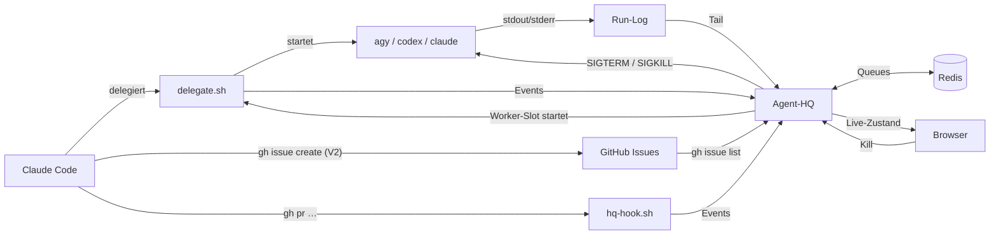
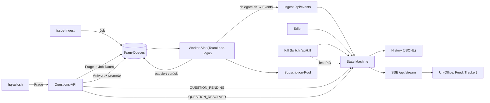
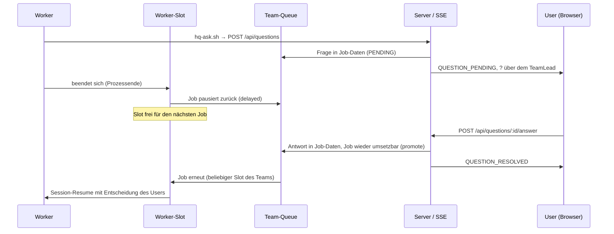

# Architektur-Dokumentation (nach arc42)

## 1. Einführung und Ziele

### 1.1 Aufgabenstellung

Agent-HQ ist ein lokales Monitoring-Dashboard für das Multi-Agenten-Setup aus Claude Code (Lead Architect) und den Subagents `agy` / `codex`. Es empfängt Events aus `delegate.sh` und einem Claude-Code-Hook, wertet Run-Logs aus und zeigt den Zustand live als 16-Bit „Virtual Office“, Live-Feed und Ticket-Tracker. Ein Kill Switch beendet laufende Subagents. Details: [PROJECT_PLAN.md](../../PROJECT_PLAN.md).

**V2** macht Agent-HQ zusätzlich zum Orchestrator ([Konzept](../concepts/multi-team-queue-architecture.md), [ADR-0006](../adr/0006-queue-architektur-v2.md)): GitHub Issues mit Label `team:*` landen in Redis/BullMQ-Queues pro Team (Frontend, Backend, QA). Ein Pool aus 4 Worker-Slots arbeitet sie in Worktrees über `delegate.sh` ab, wechseln bei Rate-Limits die Subscription und erstellen Draft-PRs. Rückfragen an den User erscheinen als `?` im Büro und werden im Browser beantwortet.

### 1.2 Qualitätsziele

| Ziel                   | Bedeutung                                                                                                                                |
| :--------------------- | :--------------------------------------------------------------------------------------------------------------------------------------- |
| Nicht-Blockierung      | Der Terminal-Workflow läuft weiter, auch wenn Agent-HQ fehlt oder hängt (max. 0.5 s Verzögerung).                                        |
| Aktualität             | Events erscheinen live im Browser; nach Reload ist der Zustand sofort vollständig (`INIT_STATE`).                                        |
| Sicherheit (lokal)     | Bind nur an `127.0.0.1`, `Origin`-Prüfung, Kill nur für selbst registrierte PIDs.                                                        |
| Einfachheit (Ponytail) | Eine App, keine API-Keys, Standard-UNIX-Mechanismen. Redis (Docker) nur als Task-Queue für V2.                                           |
| Ausfallsicherheit (V2) | Tasks und offene Rückfragen überleben Neustarts; ohne Redis läuft das V1-Monitoring weiter.                                              |
| Zero-Babysitting (V2)  | Der Lead schreibt nur Issues; Testfehler werden über Queue-Retries repariert (max. 3), Rate-Limits per Subscription-Failover abgefangen. |

### 1.3 Stakeholder

| Rolle               | Erwartung                                                                                                    |
| :------------------ | :----------------------------------------------------------------------------------------------------------- |
| Entwickler (Nutzer) | Sieht auf einen Blick, wer woran arbeitet; kann Subagents sofort stoppen; beantwortet Rückfragen im Browser. |
| Claude Code         | Wird durch Monitoring nie blockiert oder verlangsamt; zerlegt Features in Issues und reviewt Draft-PRs.      |

---

## 2. Randbedingungen

- Nx Monorepo, eine SvelteKit-App (UI + Server) mit TailwindCSS ([ADR-0001](../adr/0001-nx-workspace-sveltekit.md)).
- 100 % API-Key-frei: nur lokale CLI-Tools (`claude`, `agy`, `codex`) über bestehende Abos.
- Rein lokal: Server auf `127.0.0.1:3333` (Port via `PORT`, Clients via `AGENT_HQ_URL`).
- Event-Quellen sind Bash-Skripte; Kommunikation per `curl` mit harten Timeouts.
- V2: Docker für Redis 7 (`127.0.0.1:6379`), GitHub-Zugriff ausschließlich über die `gh` CLI.

---

## 3. Kontextabgrenzung

### 3.1 Fachlicher Kontext

| Nachbar                                 | Rolle                                                                                      |
| :-------------------------------------- | :----------------------------------------------------------------------------------------- |
| Claude Code                             | Orchestrator; delegiert Tickets über `delegate.sh`, reviewt und merged PRs per `gh pr …`.  |
| `delegate.sh`                           | Startet Worker, meldet `TASK_HANDOVER`, `TASK_START`, `TASK_COMPLETE`, `TASK_FAILED`.      |
| Claude-Code-Hook (`scripts/hq-hook.sh`) | `PostToolUse`-Hook; meldet Claudes `gh pr`-Schritte (Draft, Review, Ready, Checks, Merge). |
| `agy` / `codex`                         | Worker; schreiben stdout/stderr in ein Run-Log; werden vom Kill Switch beendet.            |
| Browser                                 | Zeigt Büro, Feed und Tracker; löst den Kill Switch aus; beantwortet Rückfragen (V2).       |
| GitHub Issues (V2)                      | Einzige Quelle für Tasks; Labels `team:*` routen, `status:*` spiegeln den Fortschritt.     |
| Redis (V2)                              | Hält Team-Queues, pausierte Jobs mit Rückfragen und den Subscription-Status.               |

### 3.2 Technischer Kontext

| Schnittstelle                         | Richtung         | Protokoll / Mechanismus                                                       |
| :------------------------------------ | :--------------- | :---------------------------------------------------------------------------- |
| `POST /api/events`                    | CLI → Server     | HTTP + JSON (Event-Schema PROJECT_PLAN 4C), `curl --max-time 0.5 … \|\| true` |
| `GET /api/stream`                     | Server → Browser | Server-Sent Events, erstes Event `INIT_STATE`                                 |
| `POST /api/kill`                      | Browser → Server | HTTP + JSON `{ runId }`, `Origin`-geprüft                                     |
| `$TMPDIR/agent-hq/*.log`              | Worker → Server  | Datei, gelesen per `fs.watch` / Tail                                          |
| `~/.agent-hq/history.jsonl`           | Server           | Append-only Datei                                                             |
| Signale                               | Server → Worker  | `pkill -TERM -P`, `SIGTERM`, Fallback `SIGKILL`                               |
| Redis `127.0.0.1:6379` (V2)           | Server ↔ Redis   | BullMQ-Queues `tasks-frontend`, `tasks-backend`, `tasks-qa`                   |
| `gh issue` / `gh pr` (V2)             | Server → GitHub  | Polling offener `team:*`-Issues, Statuslabels, Draft-PRs                      |
| `GET /api/questions` (V2)             | Browser → Server | Offene Rückfragen                                                             |
| `POST /api/questions/:id/answer` (V2) | Browser → Server | HTTP + JSON `{ answer }`, `Origin`-geprüft                                    |
| `POST /api/questions` (V2)            | Worker → Server  | `scripts/hq-ask.sh` sendet die Rückfrage des Workers; danach beendet er sich  |

Siehe [ADR-0002](../adr/0002-sse-und-http-post.md), [ADR-0004](../adr/0004-worker-als-hintergrundprozess.md) und [ADR-0006](../adr/0006-queue-architektur-v2.md).

---

## 4. Lösungsstrategie

| Entscheidung                                                                     | ADR                                                           |
| :------------------------------------------------------------------------------- | :------------------------------------------------------------ |
| Eine SvelteKit-App für UI und Server im Nx Workspace                             | [ADR-0001](../adr/0001-nx-workspace-sveltekit.md)             |
| HTTP-POST für eingehende Events, SSE für den Live-Stream                         | [ADR-0002](../adr/0002-sse-und-http-post.md)                  |
| Zustand im Speicher, Historie als append-only JSONL                              | [ADR-0003](../adr/0003-jsonl-historie.md)                     |
| Worker als Hintergrundprozess mit echter PID und Exit-Code-Events                | [ADR-0004](../adr/0004-worker-als-hintergrundprozess.md)      |
| Korrektur per Abbruch und Session-Fortsetzung statt PTY-Chat                     | [ADR-0005](../adr/0005-kein-pty-chat-korrektur-per-resume.md) |
| Redis/BullMQ-Team-Queues, Worker-Pool mit 4 Slots, Rückfragen als pausierte Jobs | [ADR-0006](../adr/0006-queue-architektur-v2.md)               |

---

## 5. Bausteinsicht

### Ebene 1: Gesamtsystem

- `apps/agent-hq`: SvelteKit-App mit UI (`src/routes/`, `src/lib/components/`) und Server (`src/lib/server/`, `src/routes/api/`). In V2 laufen hier auch Ingest und der Worker-Pool.
- `libs/queue` (V2): Typen und BullMQ-Factory für Queues und Worker.
- `scripts/`: `delegate.sh` (Referenz für den Skill), `hq-hook.sh` und `hq-ask.sh` (V2, Rückfragen des Workers).
- `docker-compose.yml` (V2): Redis 7.

### Ebene 2: Detailbausteine

| Baustein                    | Ort                                         | Verantwortung                                                                                                                                                                                                                                         |
| :-------------------------- | :------------------------------------------ | :---------------------------------------------------------------------------------------------------------------------------------------------------------------------------------------------------------------------------------------------------- |
| Ingest                      | `routes/api/events`                         | Nimmt Events per POST an, prüft `Origin`, setzt `timestamp`, übergibt an die State Machine.                                                                                                                                                           |
| State Machine               | `lib/server/state.ts`                       | Hält Agents, Runs, PIDs, Räume im Speicher; leitet `room` und Zustand aus Events ab; liefert `INIT_STATE`.                                                                                                                                            |
| Tailer                      | `lib/server/tail.ts`                        | Beobachtet `$TMPDIR/agent-hq/`, erzeugt `TASK_PROGRESS` und `RATE_LIMITED` aus Run-Logs.                                                                                                                                                              |
| SSE                         | `lib/server/sse.ts`, `routes/api/stream`    | Verteilt Zustandsänderungen an alle Browser; sendet zuerst `INIT_STATE`.                                                                                                                                                                              |
| History                     | `lib/server/history.ts`                     | Hängt jedes Event an `~/.agent-hq/history.jsonl` an; liefert die letzten Läufe.                                                                                                                                                                       |
| Kill Switch                 | `routes/api/kill`                           | Beendet nur registrierte PIDs (Kindprozesse, `SIGTERM`, nach 1.5 s `SIGKILL`); erzeugt `TASK_ABORTED`.                                                                                                                                                |
| Issue-Ingest (V2)           | `lib/server`                                | Pollt `team:*`-Issues per `gh`, reiht sie in die Team-Queue ein (Job-ID ist `issue-<Nummer>` (BullMQ verbietet rein numerische IDs)), setzt `status:*`-Labels.                                                                                        |
| Worker-Pool / TeamLead (V2) | `lib/server`                                | 4 Slots über die Team-Queues (Frontend 2, Backend 1, QA 1). Je Job: Worktree anlegen, Provider wählen, `delegate.sh` starten und bis Prozessende halten, Draft-PR, Rückfragen pausieren. Der TeamLead ist die Team-Logik darin, kein eigener Prozess. |
| Subscription-Pool (V2)      | `lib/server`                                | Provider-Status `AVAILABLE`/`COOLDOWN` in Redis, Failover nach Team-Präferenz; nutzt `ratelimit.ts`.                                                                                                                                                  |
| Questions-API (V2)          | `routes/api/questions`, `scripts/hq-ask.sh` | Nimmt Rückfragen des Workers in die Job-Daten auf; listet offene Fragen; schreibt die Antwort in den Job und stellt ihn wieder ein.                                                                                                                   |

---

## 6. Laufzeitsicht

Delegationslauf (vereinfacht):

1. `delegate.sh` sendet `TASK_HANDOVER`, startet den Worker im Hintergrund und sendet `TASK_START` mit PID.
2. Der Tailer liest das Run-Log und erzeugt `TASK_PROGRESS` / `RATE_LIMITED`.
3. Nach Prozessende sendet `delegate.sh` `TASK_COMPLETE` bzw. `TASK_FAILED` mit Exit-Code.
4. Claudes `gh pr`-Schritte erzeugen über den Hook `DRAFT_PR_CREATED` … `MERGED`.
5. Jede Zustandsänderung geht per SSE an alle Browser.

Zustandsdiagramm der Figuren: [PROJECT_PLAN.md, Abschnitt 3](../../PROJECT_PLAN.md).

### Team-Task (V2)

1. Claude oder der User legt ein Issue mit Label `team:<x>` an. Der Ingest reiht es in `tasks-<x>` ein und setzt `status:queued`.
2. Ein freier Worker-Slot des Teams nimmt den Job, setzt `status:in-progress`, legt `.worktrees/feat-<ID>-<slug>` an und wählt den Provider über den Subscription-Pool.
3. Er startet `delegate.sh`; der Lauf erscheint wie gewohnt im Büro. Bei einem Rate-Limit setzt er den Provider auf `COOLDOWN`, sendet `SUBSCRIPTION_FAILOVER` und startet den Job sofort mit dem Fallback neu.
4. Bis zum Prozessende hält der Slot den Job. Schlägt der Lauf fehl, geht der Job mit der Fehlerausgabe als BullMQ-Retry zurück in die Queue (bis zu 3 Reparaturen), der Slot ist frei. Sind die Tests grün, pusht er und erstellt einen Draft-PR (`Closes #<ID>`). Danach reviewt Claude wie bisher.

### Rückfrage (V2)

Der Job wird bei einer Rückfrage als pausiert auf die Queue des TeamLeads zurückgeschrieben und bleibt dort, bis der User antwortet. Danach steht er mit der Entscheidung des Users wieder als umsetzbar in der Queue. Details: [ADR-0006](../adr/0006-queue-architektur-v2.md).

---

## 7. Verteilungssicht

Ein Node.js-Prozess auf dem Entwickler-Rechner (`nx serve agent-hq` bzw. `./run.sh`), gebunden an `127.0.0.1:3333`. Keine Cloud. In V2 startet `run.sh` vorher den Redis-Container (`docker compose up -d redis`, `127.0.0.1:6379`, Volume `redis_data`); ohne Docker läuft nur V1.

---

## 8. Querschnittliche Konzepte

- **Graceful Degradation**: Alle CLI-Calls mit `--connect-timeout 0.1 --max-time 0.5` und `|| true`; Hook gibt immer Exit 0 zurück.
- **Sicherheit**: Bind an `127.0.0.1`, `Origin`-Prüfung auf POST-Endpunkten, Kill nur für registrierte PIDs.
- **Datenmodell**: Einheitliches Event-JSON ([PROJECT_PLAN.md, Abschnitt 4C](../../PROJECT_PLAN.md)). V2 ergänzt `SUBSCRIPTION_FAILOVER`, `QUESTION_PENDING` und `QUESTION_RESOLVED` ([ADR-0006](../adr/0006-queue-architektur-v2.md)).
- **Isolation (V2)**: Worker-Slots arbeiten nie auf `main`, sondern in `.worktrees/feat-<ID>-<slug>`; bei Fehlschlag bleibt der Worktree zur Analyse erhalten.

---

## 9. Architekturentscheidungen

Siehe [`docs/adr/`](../adr/):

- [ADR-0001: Nx Workspace mit einer SvelteKit-App (UI + Server)](../adr/0001-nx-workspace-sveltekit.md)
- [ADR-0002: SSE für Server→Browser, HTTP-POST für CLI→Server](../adr/0002-sse-und-http-post.md)
- [ADR-0003: Append-only JSONL-Historie statt SQLite](../adr/0003-jsonl-historie.md)
- [ADR-0004: Worker als Hintergrundprozess in delegate.sh statt `exec … | tee`](../adr/0004-worker-als-hintergrundprozess.md)
- [ADR-0005: Kein PTY-Chat – Korrektur per Abbruch und Session-Fortsetzung](../adr/0005-kein-pty-chat-korrektur-per-resume.md)
- [ADR-0006: Redis/BullMQ-Team-Queues, Worker-Pool und Rückfragen als pausierte Jobs (V2)](../adr/0006-queue-architektur-v2.md)
