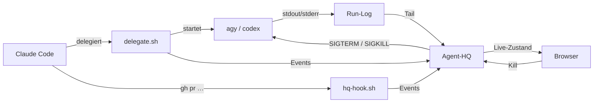
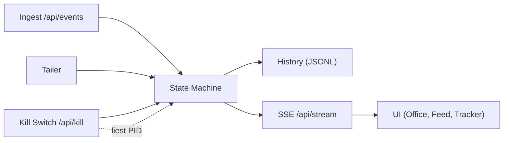

# Architektur-Dokumentation (nach arc42)

## 1. Einführung und Ziele

### 1.1 Aufgabenstellung

Agent-HQ ist ein lokales Monitoring-Dashboard für das Multi-Agenten-Setup aus Claude Code (Lead Architect) und den Subagents `agy` / `codex`. Es empfängt Events aus `delegate.sh` und einem Claude-Code-Hook, wertet Run-Logs aus und zeigt den Zustand live als 16-Bit „Virtual Office“, Live-Feed und Ticket-Tracker. Ein Kill Switch beendet laufende Subagents. Details: [PROJECT_PLAN.md](../../PROJECT_PLAN.md).

### 1.2 Qualitätsziele

| Ziel                   | Bedeutung                                                                                         |
| :--------------------- | :------------------------------------------------------------------------------------------------ |
| Nicht-Blockierung      | Der Terminal-Workflow läuft weiter, auch wenn Agent-HQ fehlt oder hängt (max. 0.5 s Verzögerung). |
| Aktualität             | Events erscheinen live im Browser; nach Reload ist der Zustand sofort vollständig (`INIT_STATE`). |
| Sicherheit (lokal)     | Bind nur an `127.0.0.1`, `Origin`-Prüfung, Kill nur für selbst registrierte PIDs.                 |
| Einfachheit (Ponytail) | Eine App, keine Datenbank, keine API-Keys, Standard-UNIX-Mechanismen.                             |

### 1.3 Stakeholder

| Rolle               | Erwartung                                                                 |
| :------------------ | :------------------------------------------------------------------------ |
| Entwickler (Nutzer) | Sieht auf einen Blick, wer woran arbeitet; kann Subagents sofort stoppen. |
| Claude Code         | Wird durch Monitoring nie blockiert oder verlangsamt.                     |

---

## 2. Randbedingungen

- Nx Monorepo, eine SvelteKit-App (UI + Server) mit TailwindCSS ([ADR-0001](../adr/0001-nx-workspace-sveltekit.md)).
- 100 % API-Key-frei: nur lokale CLI-Tools (`claude`, `agy`, `codex`) über bestehende Abos.
- Rein lokal: Server auf `127.0.0.1:3333` (Port via `PORT`, Clients via `AGENT_HQ_URL`).
- Event-Quellen sind Bash-Skripte; Kommunikation per `curl` mit harten Timeouts.

---

## 3. Kontextabgrenzung

### 3.1 Fachlicher Kontext

| Nachbar                                 | Rolle                                                                                      |
| :-------------------------------------- | :----------------------------------------------------------------------------------------- |
| Claude Code                             | Orchestrator; delegiert Tickets über `delegate.sh`, reviewt und merged PRs per `gh pr …`.  |
| `delegate.sh`                           | Startet Worker, meldet `TASK_HANDOVER`, `TASK_START`, `TASK_COMPLETE`, `TASK_FAILED`.      |
| Claude-Code-Hook (`scripts/hq-hook.sh`) | `PostToolUse`-Hook; meldet Claudes `gh pr`-Schritte (Draft, Review, Ready, Checks, Merge). |
| `agy` / `codex`                         | Worker; schreiben stdout/stderr in ein Run-Log; werden vom Kill Switch beendet.            |
| Browser                                 | Zeigt Büro, Feed und Tracker; löst den Kill Switch aus.                                    |

### 3.2 Technischer Kontext

| Schnittstelle               | Richtung         | Protokoll / Mechanismus                                                       |
| :-------------------------- | :--------------- | :---------------------------------------------------------------------------- |
| `POST /api/events`          | CLI → Server     | HTTP + JSON (Event-Schema PROJECT_PLAN 4C), `curl --max-time 0.5 … \|\| true` |
| `GET /api/stream`           | Server → Browser | Server-Sent Events, erstes Event `INIT_STATE`                                 |
| `POST /api/kill`            | Browser → Server | HTTP + JSON `{ runId }`, `Origin`-geprüft                                     |
| `$TMPDIR/agent-hq/*.log`    | Worker → Server  | Datei, gelesen per `fs.watch` / Tail                                          |
| `~/.agent-hq/history.jsonl` | Server           | Append-only Datei                                                             |
| Signale                     | Server → Worker  | `pkill -TERM -P`, `SIGTERM`, Fallback `SIGKILL`                               |

Siehe [ADR-0002](../adr/0002-sse-und-http-post.md) und [ADR-0004](../adr/0004-worker-als-hintergrundprozess.md).

---

## 4. Lösungsstrategie

| Entscheidung                                                      | ADR                                                      |
| :---------------------------------------------------------------- | :------------------------------------------------------- |
| Eine SvelteKit-App für UI und Server im Nx Workspace              | [ADR-0001](../adr/0001-nx-workspace-sveltekit.md)        |
| HTTP-POST für eingehende Events, SSE für den Live-Stream          | [ADR-0002](../adr/0002-sse-und-http-post.md)             |
| Zustand im Speicher, Historie als append-only JSONL               | [ADR-0003](../adr/0003-jsonl-historie.md)                |
| Worker als Hintergrundprozess mit echter PID und Exit-Code-Events | [ADR-0004](../adr/0004-worker-als-hintergrundprozess.md) |

---

## 5. Bausteinsicht

### Ebene 1: Gesamtsystem

- `apps/agent-hq`: SvelteKit-App mit UI (`src/routes/`, `src/lib/components/`) und Server (`src/lib/server/`, `src/routes/api/`).
- `scripts/`: `delegate.sh` (Referenz für den Skill) und `hq-hook.sh`.
- Keine `libs/` (YAGNI, siehe [ADR-0001](../adr/0001-nx-workspace-sveltekit.md)).

### Ebene 2: Detailbausteine

| Baustein      | Ort                                      | Verantwortung                                                                                              |
| :------------ | :--------------------------------------- | :--------------------------------------------------------------------------------------------------------- |
| Ingest        | `routes/api/events`                      | Nimmt Events per POST an, prüft `Origin`, setzt `timestamp`, übergibt an die State Machine.                |
| State Machine | `lib/server/state.ts`                    | Hält Agents, Runs, PIDs, Räume im Speicher; leitet `room` und Zustand aus Events ab; liefert `INIT_STATE`. |
| Tailer        | `lib/server/tail.ts`                     | Beobachtet `$TMPDIR/agent-hq/`, erzeugt `TASK_PROGRESS` und `RATE_LIMITED` aus Run-Logs.                   |
| SSE           | `lib/server/sse.ts`, `routes/api/stream` | Verteilt Zustandsänderungen an alle Browser; sendet zuerst `INIT_STATE`.                                   |
| History       | `lib/server/history.ts`                  | Hängt jedes Event an `~/.agent-hq/history.jsonl` an; liefert die letzten Läufe.                            |
| Kill Switch   | `routes/api/kill`                        | Beendet nur registrierte PIDs (Kindprozesse, `SIGTERM`, nach 1.5 s `SIGKILL`); erzeugt `TASK_ABORTED`.     |

---

## 6. Laufzeitsicht

Delegationslauf (vereinfacht):

1. `delegate.sh` sendet `TASK_HANDOVER`, startet den Worker im Hintergrund und sendet `TASK_START` mit PID.
2. Der Tailer liest das Run-Log und erzeugt `TASK_PROGRESS` / `RATE_LIMITED`.
3. Nach Prozessende sendet `delegate.sh` `TASK_COMPLETE` bzw. `TASK_FAILED` mit Exit-Code.
4. Claudes `gh pr`-Schritte erzeugen über den Hook `DRAFT_PR_CREATED` … `MERGED`.
5. Jede Zustandsänderung geht per SSE an alle Browser.

Zustandsdiagramm der Figuren: [PROJECT_PLAN.md, Abschnitt 3](../../PROJECT_PLAN.md).

---

## 7. Verteilungssicht

Ein Node.js-Prozess auf dem Entwickler-Rechner (`nx serve agent-hq` bzw. `./run.sh`), gebunden an `127.0.0.1:3333`. Keine Container, keine Cloud.

---

## 8. Querschnittliche Konzepte

- **Graceful Degradation**: Alle CLI-Calls mit `--connect-timeout 0.1 --max-time 0.5` und `|| true`; Hook gibt immer Exit 0 zurück.
- **Sicherheit**: Bind an `127.0.0.1`, `Origin`-Prüfung auf POST-Endpunkten, Kill nur für registrierte PIDs.
- **Datenmodell**: Einheitliches Event-JSON ([PROJECT_PLAN.md, Abschnitt 4C](../../PROJECT_PLAN.md)).

---

## 9. Architekturentscheidungen

Siehe [`docs/adr/`](../adr/):

- [ADR-0001: Nx Workspace mit einer SvelteKit-App (UI + Server)](../adr/0001-nx-workspace-sveltekit.md)
- [ADR-0002: SSE für Server→Browser, HTTP-POST für CLI→Server](../adr/0002-sse-und-http-post.md)
- [ADR-0003: Append-only JSONL-Historie statt SQLite](../adr/0003-jsonl-historie.md)
- [ADR-0004: Worker als Hintergrundprozess in delegate.sh statt `exec … | tee`](../adr/0004-worker-als-hintergrundprozess.md)
