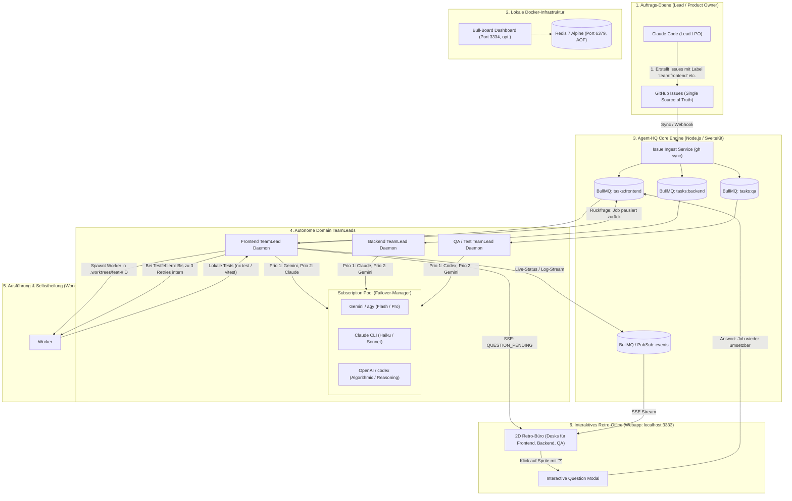
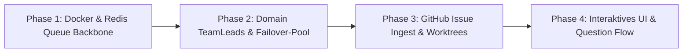

# Architektur- und Umsetzungsplan: Multi-Team Queue Architecture & Subscription Orchestrator (V2)

> **Dokumenttyp:** Masterplan & Architektur-Spezifikation (V2)  
> **Projekt:** Agent-HQ  
> **Zielgruppe:** Lead Architect (Claude Code) & Subagents (`agy`, `codex`)  
> **Status:** Genehmigt zur schrittweisen Umsetzung

---

## 1. Vision & Leitprinzipien

**Agent-HQ V2** erweitert das bisherige lokale Monitoring-Dashboard zu einer vollwertigen, asynchronen **Webapplikation für Multi-Agenten-Orchestrierung**.

### Kernprobleme, die V2 löst:

1. **Lead-Befreiung (Zero-Babysitting & Zero-Coding):** Der Overall Lead (Claude Code) schreibt keinen Code mehr und überwacht keine Terminals oder Logs. Er zerlegt Epics/Features rein in GitHub Issues und stößt diese an.
2. **Subscription-Arbitrage (100 % API-Key-frei & Ausfallsicher):** Teams arbeiten über vorhandene Flatrate-Subscriptions (`agy` / Gemini, `claude`, `codex`). Läuft eine Subscription in ein Quota-/Rate-Limit (z. B. HTTP 429), schaltet das Team vollautomatisch auf eine Ausweich-Subscription um.
3. **Fachliche Spezialisierung:** Teams sind nach Domänen organisiert (_Frontend_, _Backend_, _QA_) und greifen dynamisch auf den gemeinsamen Subscription-Pool zu.
4. **Human-in-the-Loop ohne Terminal-Blockade:** Fachliche Rückfragen oder Designentscheidungen blockieren keinen Terminal-Prompt, sondern ploppen in der Web-UI als interaktives **`?` in der Sprechblase** des jeweiligen TeamLeads auf. Der User antwortet im Browser.

---

## 2. Gesamtarchitektur



---

## 3. Die Komponenten im Detail

### 3.1. Externe Services via Docker (`docker-compose.yml`)

Alle externen Abhängigkeiten laufen containerisiert, um das Host-System sauber zu halten.

- **Redis 7 (Alpine):**
  - Bindung: `127.0.0.1:6379:6379`
  - Persistenz: Docker Volume `redis_data` mit Append-Only File (`--appendonly yes`).
  - Keine Datenverluste bei Container-Neustarts.
- **Bull-Board (Optional für Dev):**
  - Bindung: `127.0.0.1:3334:3000`
  - Ermöglicht visuelle Inspektion aller Queues, aktiven Jobs, Retries und Dead-Letter-Queues im Browser.
- **Lifecycle (`run.sh`):**
  - Vor Start des SvelteKit-Servers prüft `run.sh`, ob Docker läuft, und führt automatisch `docker compose up -d redis` aus.

---

### 3.2. Fachliche Teams & Subscription-Pool

Teams sind nach ihrer funktionalen Spezialisierung strukturiert. Jedes Team verfügt über eine primäre Subscription-Präferenz, besitzt jedoch eine definierte Fallback-Kaskade bei Rate-Limits.

| Team                 | Domäne / Fachlichkeit                                  | Primäre Subscription              | Sekundäre Subscription (Fallback) |
| :------------------- | :----------------------------------------------------- | :-------------------------------- | :-------------------------------- |
| **Frontend Team**    | SvelteKit, Tailwind, UI-Komponenten, Asset-Handling    | `agy` (Gemini 3.8 Flash / Pro)    | `claude` (Sonnet)                 |
| **Backend Team**     | APIs, Queue-Handler, DB-Stores, System-Services        | `claude` (Sonnet)                 | `agy` (Gemini 3.8 Pro)            |
| **QA / Review Team** | Unit- & Integrationstests, Edge-Cases, Security-Audits | `codex` (OpenAI o-Serie / GPT-4o) | `agy` (Gemini 3.8 Pro)            |

#### Automatische Failover-Logik im Subscription-Pool:

1. Der TeamLead startet den Job mit der primären Subscription.
2. Schlägt der CLI-Aufruf mit einem typischen Quota-/Rate-Limit-Fehler fehl (`HTTP 429`, `limit reached`, `tokens exhausted`):
   - Der TeamLead setzt den Status der betroffenen Subscription auf `COOLDOWN` bis zum angegebenen Reset-Zeitpunkt.
   - Der Task wird **nicht abgebrochen**, sondern sofort mit der sekundären Subscription neu gestartet.
   - Ein Info-Event (`SUBSCRIPTION_FAILOVER`) wird an die UI gestreamt.

---

### 3.3. GitHub Issues als Single Source of Truth

Kein Task existiert außerhalb von GitHub Issues. Das garantiert vollständige Nachvollziehbarkeit.

#### Workflow:

1. **Erstellung:**
   - Lead (Claude) oder User erstellt ein GitHub Issue:
     ```bash
     gh issue create --title "feat(frontend): create question modal" \
       --label "team:frontend,size:small" \
       --body "## Ziel & Akzeptanzkriterien..."
     ```
2. **Ingest & Routing:**
   - Der Ingest-Service lauscht auf neue Issues mit Label `team:*`.
   - Das Issue wird als BullMQ-Job in die entsprechende Domain-Queue geschoben:
     - `team:frontend` -> Queue `tasks:frontend`
     - `team:backend` -> Queue `tasks:backend`
     - `team:qa` -> Queue `tasks:qa`
3. **Ausführung in Worktree:**
   - Der TeamLead erstellt automatisch einen isolierten Git-Worktree: `.worktrees/feat-#<ISSUE_ID>-<slug>`.
   - Der Subagent implementiert die Änderungen und committet via Conventional Commits: `feat(#<ISSUE_ID>): ...`.
4. **Draft PR:**
   - Sobald alle internen Tests grün sind, pusht der TeamLead den Branch und erstellt einen Draft PR:
     ```bash
     gh pr create --draft --title "feat(#<ISSUE_ID>): ..." --body "Closes #<ISSUE_ID>"
     ```
   - Das Issue wird auf GitHub mit dem PR verknüpft.

---

### 3.4. Zero-Babysitting & Autonome Selbstheilung

Der Lead überwacht keine Terminals. Der TeamLead fungiert als autonomer Supervisor:

- **Interne Testschleife:** Nach der Code-Generierung führt der TeamLead `nx test <projekt>` oder `vitest` im Worktree aus.
- **Selbstkorrektur (Max 3 Versuche):** Schlagen Tests fehl, übergibt der TeamLead die Fehlermeldungen direkt an den Worker:
  - _„Test A ist fehlgeschlagen mit Fehler X. Bitte korrigiere die Implementierung.“_
- **Lead bleibt unbelastet:** Erst wenn die Tests grün sind (oder nach 3 Versuchen ein echter unauflösbarer Fehler auftritt), wechselt der Task-Status.

---

### 3.5. Human-in-the-Loop Protocol (Das interaktive `?`-System)

Wenn ein Worker oder TeamLead eine Designentscheidung oder fehlende Spezifikation benötigt:

1. **Job-Pausierung:** Der Worker sendet seine Frage per `scripts/hq-ask.sh` an `POST /api/questions`; der Server schreibt sie in die Job-Daten. Danach beendet sich der Worker. Der Worker-Slot schreibt den Job **als pausiert auf die Team-Queue** zurück (BullMQ-Zustand `delayed`) und ist sofort frei für den nächsten Job ([ADR-0006](../adr/0006-queue-architektur-v2.md)):
   ```json
   {
     "id": "q-123",
     "issueId": 95,
     "team": "frontend",
     "question": "Soll das Modal als Svelte 5 Snippet oder als separate Komponente implementiert werden?",
     "options": ["Separate Komponente (Empfohlen)", "Snippet"],
     "status": "PENDING"
   }
   ```
2. **UI-Benachrichtigung:**
   - Über SSE sendet Agent-HQ das Event `QUESTION_PENDING` an das Frontend.
   - Der entsprechende TeamLead-Charakter im Retro-Büro bekommt ein animiertes **`?` über dem Sprite**.
3. **Interaktion:**
   - Der User klickt auf den Charakter -> Das **Question Modal** öffnet sich mit Kontext, Frage und Auswahloptionen/Freitext.
   - Der User bestätigt seine Antwort.
4. **Wiederaufnahme:**
   - Die Antwort wird über `POST /api/questions/:id/answer` an den Server gesendet.
   - Der Server schreibt die Entscheidung des Users in die Job-Daten und stellt den Job wieder als umsetzbar in die Team-Queue (`QUESTION_RESOLVED`).
   - Ein Worker-Slot des Teams nimmt den Job erneut auf und setzt die Worker-Session mit der Entscheidung fort (Session-Resume, ADR 0005).

---

## 4. Phasenweiser Umsetzungs- und Ticketplan

Dieser Plan ist so strukturiert, dass **Claude Code (Lead)** die Tickets einzeln oder in kleinen Paketen an Subagents (`agy` / `codex`) delegieren kann, ohne selbst Code zu schreiben.



---

### Phase 1: Docker-Infrastruktur & Redis/BullMQ Backbone

> **Fokus:** Bereitstellung von Redis und den grundlegenden Queue-Services.

#### Ticket 1.1: `feat(infra): Docker Compose Setup für Redis & Bull-Board`

- **Agent:** `agent:agy`
- **Ziel:** Erstellung von `docker-compose.yml` mit `redis:7-alpine` (AOF-Persistenz) und optionalem `bull-board`.
- **Akzeptanzkriterien:**
  - `docker-compose.yml` startet Redis auf `127.0.0.1:6379`.
  - `run.sh` prüft die Docker-Verfügbarkeit und startet Redis automatisch vor dem Serverstart.
  - `docker compose down` bzw. Stoppen des Containers persistiert die Daten im Volume `redis_data`.

#### Ticket 1.2: `feat(queue): BullMQ Queue Core Service in libs/queue`

- **Agent:** `agent:agy`
- **Ziel:** TypeScript-Bibliothek/Modul zur Initialisierung von BullMQ-Queues (`tasks:frontend`, `tasks:backend`, `tasks:qa`; Rückfragen sind pausierte Jobs dieser Queues, siehe ADR 0006).
- **Akzeptanzkriterien:**
  - Saubere TypeScript-Typen für Jobs, TaskPayload, EventPayload, QuestionPayload.
  - Robuste Reconnection-Logik für Redis.
  - Unit-Tests mit Mock-Redis bzw. In-Memory-Validierung.

---

### Phase 2: Domain TeamLeads & Subscription-Pool

> **Fokus:** Autonome Worker-Daemons und Subscription-Failover.

#### Ticket 2.1: `feat(pool): Subscription-Pool Manager & Provider Failover`

- **Agent:** `agent:codex`
- **Ziel:** Modul zur Verwaltung von CLI-Providern (`agy`, `claude`, `codex`) mit Cooldown- und Fallback-Tracking.
- **Akzeptanzkriterien:**
  - Erkennt Rate-Limits und Exit-Codes aus CLI-Aufrufen.
  - Schaltet bei Fehler automatisch auf den definierten Fallback-Provider um.
  - Emittiert Events bei Provider-Wechsel (`SUBSCRIPTION_FAILOVER`).

#### Ticket 2.2: `feat(teamlead): Autonome TeamLead Worker Daemons`

- **Agent:** `agent:agy`
- **Ziel:** BullMQ Worker für die Queues `tasks:frontend`, `tasks:backend`, `tasks:qa`.
- **Akzeptanzkriterien:**
  - Worker nimmt Job entgegen und reserviert ihn.
  - Wählt passendes Modell über den Subscription-Pool.
  - Führt die bestehende `delegate.sh` im Hintergrund aus.
  - Fängt Fehler ab und unterstützt bis zu 3 Reparaturversuche.

---

### Phase 3: GitHub Issue Ingest & Worktree Automation

> **Fokus:** Verbindung von GitHub Issues mit den Queues und isolierten Git-Worktrees.

#### Ticket 3.1: `feat(ingest): GitHub Issue Poller & Queue Ingest`

- **Agent:** `agent:agy`
- **Ziel:** Service, der per `gh issue list` offene Issues mit Label `team:*` liest und in die entsprechende Queue einsteuert.
- **Akzeptanzkriterien:**
  - Vermeidung von Duplikaten (Job-ID = Issue-Nummer).
  - Aktualisiert GitHub Labels (z. B. `status:in-progress`, `status:blocked`).

#### Ticket 3.2: `feat(git): Automatisches Worktree-Handling im TeamLead`

- **Agent:** `agent:agy`
- **Ziel:** TeamLead erstellt vor Job-Start `.worktrees/feat-#<ID>-<slug>` und räumt ihn nach erfolgreichem PR-Push auf.
- **Akzeptanzkriterien:**
  - Isolation garantiert: Kein TeamLead arbeitet direkt auf `main`.
  - Bei Fehlschlag bleibt der Worktree zur Fehleranalyse erhalten.

---

### Phase 4: Interaktives UI & Human-in-the-Loop

> **Fokus:** Das 2D-Büro interaktiv machen (`?`-Sprechblase und Frage-Modal).

#### Ticket 4.1: `feat(api): Questions API & SSE Event Stream`

- **Agent:** `agent:agy`
- **Ziel:** Endpoints für Rückfragen (`GET /api/questions`, `POST /api/questions/:id/answer`) und SSE-Event-Broadcasting.
- **Akzeptanzkriterien:**
  - SSE sendet `QUESTION_PENDING` und `QUESTION_RESOLVED`.
  - Beantwortete Fragen stellen den pausierten Job mit der Entscheidung wieder als umsetzbar in die Team-Queue.

#### Ticket 4.2: `feat(ui): Animierte '?' Sprechblase & Question Modal im Retro-Office`

- **Agent:** `agent:agy`
- **Ziel:** Erweiterung der Canvas-/Svelte-UI im Retro-Büro.
- **Akzeptanzkriterien:**
  - Sprite des blockierten TeamLeads zeigt ein animiertes Fragezeichen `?`.
  - Klick auf das Sprite öffnet ein Dialogfenster mit Frage, Issue-Details und Antwortfeld.
  - Nach dem Absenden verschwindet das `?` und der Status wechselt zurück auf „Arbeitend“.

---

## 5. Übergabe an Claude Code (Execution Instructions)

Sobald Claude Code diesen Masterplan übernimmt, lautet die Anweisung für den Orchestrator:

1. **Nicht selbst coden:** Keine manuellen Datei-Edits oder Boilerplate-Generierung durch Claude.
2. **Delegation über Subagent-Skill:**
   - Tickets aus Phase 1 nacheinander über GitHub Issues anlegen (`agent:agy` oder `agent:codex`).
   - Delegation ausführen (`delegate.sh agy` bzw. `delegate.sh codex`).
   - Reviews gegen Akzeptanzkriterien durchführen und PRs mergen.
3. **Phasen-Gatekeeping:** Erst nach erfolgreichem Abschluss von Phase 1 mit Phase 2 fortfahren.
