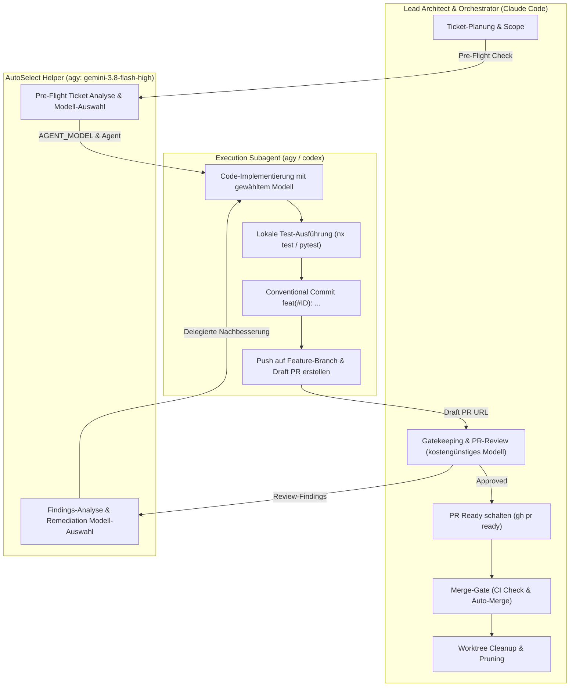

# Konzept: Subagent-Orchestrator Skill

> **Dokumenttyp:** Architektur- und Workflow-Konzept  
> **Projekt:** Agent-HQ  
> **Kontext:** Multi-Agent Engineering Workflow (`Claude Code` als Lead Architect & `agy` / `codex` als Subagents)

---

## 1. Motivation & Zielsetzung

Der **Subagent-Orchestrator** regelt die Zusammenarbeit zwischen dem **Lead Architect (Claude Code)** und lokalen **Subagents (`agy` / Antigravity, `codex`)**.

### Kernprobleme, die der Skill löst:

1. **Context-Window-Bloat vermeiden:** Das Schreiben von hunderten Zeilen Code, Test-Generierung und Debug-Loops in der Haupt-Session füllt das Kontextfenster von Claude rasant. Durch Delegation an lokale Subagents bleibt der Kontext von Claude schlank und auf Architektur, Planung und Gatekeeping fokussiert.
2. **Kosten- & Token-Optimierung (100 % API-Key-frei):** Subagents laufen über bestehende lokale CLI-Subscriptions (`agy`, `codex`) auf dem Entwickler-Rechner, ohne zusätzliche API-Token-Kosten.
3. **Qualitätssicherung durch striktes Gatekeeping:** Subagents dürfen keinen Code unkontrolliert mergen. Jeder Code durchläuft einen Review-Prozess gegen definierte Akzeptanzkriterien und CI-Pipelines.

---

## 2. Rollenverteilung



---

## 3. Der 7-Schritte Delegations-Workflow

### Schritt 1: Scoping & Ticket-Planung (Claude)

- Bevor Code geschrieben wird, existiert ein präzises Ticket (GitHub Issue oder `docs/tickets/`).
- **Must-Have Agent-Empfehlung & Zuweisung**: Jedes Ticket enthält zwingend eine Empfehlung, welcher Agent die Aufgabe umsetzen soll:
  - **`agent:claude`**: Architektur, Scoping, Ticket-Planung, komplexe Systementscheidungen, Orchestrierung sowie Review & Merge-Gates.
  - **`agent:agy`** (Antigravity): Umfängliche Feature-Implementierung, Massen-Refactoring, Boilerplate-freie Komponenten, Test-Generierung in isolierten Worktrees.
  - **`agent:codex`**: Algorithmische Spezialaufgaben, mathematische/logische Optimierung oder Zweitmeinungen.
- **Verbindliches Label**: Jedes GitHub-Issue bzw. Ticket-Metadatum erhält zwingend das passende Agenten-Label:
  `agent:claude` | `agent:agy` | `agent:codex`
- Das Ticket enthält zwingend:
  - **Empfohlener Agent & Begründung** (`agent:claude` / `agent:agy` / `agent:codex`)
  - **Hintergrund** (Fachlich & Technisch)
  - **Ziel** (Konkreter Zielzustand)
  - **Akzeptanzkriterien & Definition of Done (DoD)** als nummerierte/abzählbare Checkliste.
- Ausführung erfolgt immer in einem isolierten Feature-Worktree (`.worktrees/feat-<ID>-<slug>`).

### Schritt 2: Pre-Flight Task & Model AutoSelect (`autoselect.sh`)

Bevor die Implementierung startet, analysiert ein schneller, leichtgewichtiger Helper-Task das Ticket:

```bash
~/.claude/skills/subagent-orchestrator/autoselect.sh <TICKET_ID>
```

- **Funktionsweise:** Läuft über `agy` mit `gemini-3.8-flash-high` (verbraucht 0 Claude-Tokens, reagiert in wenigen Sekunden).
- **Modell-Sizing:**
  - _Standard Frontend, Svelte, Tailwind, CRUD, Unit-Tests_: `agy` mit `gemini-3.8-flash-high`
  - _Tiefe Architektur-Refactorings, Concurrency, schwierige Debug-Loops_: `agy` mit `gemini-4-argon-high`
  - _Mathematische Algorithmen, Compiler/Parser-Logik_: `codex` mit `gpt-6.1-sol`
- Gibt das ermittelte `AGENT_MODEL` und den Ziel-Agenten zurück.

### Schritt 3: Delegation an Subagent-Runner (Claude ➔ Subagent)

Claude ruft das Delegationsskript mit dem vom AutoSelect gewählten Modell auf:

```bash
AGENT_MODEL="<selected-model>" ~/.claude/skills/subagent-orchestrator/delegate.sh <selected-agent> \
  "Ticket #<ID>: <Ziel & Akzeptanzkriterien>. Nach erfolgreichen Tests: Committen, ausschließlich auf aktuellen Feature-Branch pushen und Draft PR erstellen via gh pr create --draft --title \"feat(#<ID>): <Titel>\" --body \"Closes #<ID>\"."
```

### Schritt 4: Ausführung, Push & Draft PR (Subagent)

- **Code & Tests:** Subagent editiert die Dateien und führt die Testsuite aus.
- **Commit:** Erstellt Conventional Commit (`feat(#<ID>): ...`).
- **Branch-Push:** Der Subagent darf und muss pushen, aber **ausschließlich auf den aktuellen Feature-Branch**:
  ```bash
  git push -u origin HEAD
  ```
- **Draft PR:** Erstellt unmittelbar einen Draft Pull Request:
  ```bash
  gh pr create --draft --title "<type>(#<ID>): <Titel>" --body "Closes #<ID>\n\n<Zusammenfassung>"
  ```
- Meldet die Draft-PR-URL zurück an Claude.

### Schritt 3b: Sonderfälle während der Implementierung

#### A. Blocker-Eskalation (High-Priority Ticket)

Stößt der Subagent während der Bearbeitung auf einen fundamentalen Blocker, Architekturkonflikt oder unauflösbare Abhängigkeiten:

1. **Kein unfertiger Draft PR**: Es wird unter keinen Umständen ein fehlerhafter oder unvollständiger PR erstellt.
2. **High-Priority Blocker-Ticket anlegen**:
   ```bash
   gh issue create --title "fix(#<CURRENT_ID>): Blocker - <Kurzbeschreibung>" \
     --label "bug,agent:claude" \
     --body "## Blocker für Ticket #<CURRENT_ID>&#10;&#10;### Was ist blockiert?&#10;<Beschreibung>&#10;&#10;### Erste Analyse & Erkenntnisse&#10;<Was wurde versucht, wo liegt die Hürde>&#10;&#10;### Erforderliche Architekten-Entscheidung&#10;<Entscheidungsbedarf für Claude>"
   ```
3. **Abbruch & Eskalation**: Der Subagent beendet mit Exit-Code 1 (`TASK_FAILED`) und meldet die Blocker-Ticket-ID samt Erstanalyse an Claude.
4. **Reaktion des Orchestrators**: Claude sichtet das Blocker-Ticket, klärt die Architekturfragen bzw. passt das Ticket an und startet die Delegation mit gelöstem Blocker neu.

#### B. Entdeckte Technical Debt & Security Issues (Verbot von Drive-By-Fixes)

Stößt der Subagent auf Mängel, veralteten Code oder Sicherheitsrisiken außerhalb des aktuellen Scopes:

1. **Striktes Fix-Verbot im laufenden Task**: Niemals unaufgefordert im aktuellen Ticket beheben (Scope Creep / Bruch der Testabgrenzung).
2. **Follow-Up Ticket anlegen**:
   ```bash
   gh issue create --title "<bug|enhancement>: <Titel>" \
     --label "<bug|enhancement>,agent:<claude|agy|codex>" \
     --body "## Gefundener Mangel (Technical Debt / Security)&#10;&#10;Entdeckt während der Bearbeitung von Ticket #<CURRENT_ID>.&#10;&#10;### Analyse & Risikoeinschätzung&#10;<Beschreibung>"
   ```
3. **Meldung an den Lead Architect**: Das Ticket wird in der Abschlussmeldung übergeben, damit Claude es priorisieren und regulär einplanen kann.

### Schritt 5: Review gegen Akzeptanzkriterien (Claude – mit leichtem Modell)

- **Kostengünstiges Review-Modell**: Claude führt die PR-Prüfung gegen das Ticket (`gh issue view <ID>`) und den Diff (`gh pr diff <PR_ID>`) durch. Um Token-Budget zu schonen, nutzt Claude hierfür immer ein leichtes, kosteneffizientes Modell (z.B. Sonnet/Haiku).
- **Punkt-für-Punkt-Abgleich**: Jedes einzelne **Akzeptanzkriterium** der Definition of Done wird mit dem PR-Diff abgeglichen.
- **Entscheidung**:
  - Sind alle Kriterien zu 100 % erfüllt: Weiter zu Schritt 7 (Mark Ready).
  - Liegen Mängel oder unerfüllte Kriterien vor: Weiter zu Schritt 6 (Remediation AutoSelect & Delegation).

### Schritt 6: Remediation AutoSelect & Delegierte Ausbesserung (Ping-Pong)

**Claude bessert niemals Code selbst aus.** Alle Nacharbeiten müssen an Subagents delegiert werden:

1. **AutoSelect anhand der Findings**:
   ```bash
   ~/.claude/skills/subagent-orchestrator/autoselect.sh "Findings: <Findings-Text>"
   ```
   - Kleine CSS-Anpassungen, Typos, einfache Test-Assertions ➔ `gemini-3.8-flash-high`
   - Komplexe Race-Conditions, Architektur-Mängel, Logikfehler ➔ `gemini-4-argon-high` oder `gpt-6.1-sol`
2. **Delegierte Nachbesserung**:
   ```bash
   AGENT_MODEL="<remediation-model>" ~/.claude/skills/subagent-orchestrator/delegate.sh <agent> \
     "Ticket #<ID>: Behebe die folgenden Review-Findings auf diesem Branch, teste und pushe: <Findings>"
   ```
3. Subagent pusht auf denselben Branch, und Claude prüft erneut.

### Schritt 7: Mark Ready for Review (Claude)

Erst wenn alle Akzeptanzkriterien zu 100 % erfüllt und alle Findings behoben sind, schaltet Claude den PR scharf:

```bash
gh pr ready <PR_ID>
```

### Schritt 8: CI Pipeline Check & Conditional Merge Gate (Claude)

Claude überprüft, ob für das Repository eine Feature-Branch CI-Pipeline existiert:

```bash
gh pr checks <PR_ID>
```

- **Fall A (Pipeline vorhanden):**
  Claude wartet auf das Ergebnis. Laufen alle Checks erfolgreich (`pass`), führt Claude den Merge **automatisiert** durch:
  ```bash
  gh pr merge <PR_ID> --squash --delete-branch
  ```
- **Fall B (Keine Pipeline vorhanden):**
  Claude mergt **nicht** automatisiert. Claude informiert den User, dass Review und lokale Tests grün sind, und bittet den User, den PR manuell im GitHub Web-UI freizugeben/zu mergen.

### Schritt 9: Worktree Cleanup (Claude)

Nach erfolgtem Merge wird der lokale Feature-Worktree aufgeräumt:

```bash
git worktree remove .worktrees/feat-<ID>-<slug>
git branch -d feat/<ID>-<slug> 2>/dev/null || true
git worktree prune
```

---

## 4. Technische Implementierung des Skills

### A. Skill Definition (`SKILL.md`)

Liegt global unter `~/.claude/skills/subagent-orchestrator/SKILL.md` (und gespiegelt für Gemini/agy unter `~/.gemini/config/skills/subagent-orchestrator/SKILL.md`).

### B. Runner Script (`delegate.sh`)

Führt die Tools im Terminal aus. Der Worker läuft als Hintergrundprozess: So kennt das Skript die echte Worker-PID für den Kill Switch (`$!`) und kann nach Prozessende noch `TASK_COMPLETE` / `TASK_FAILED` mit Exit-Code melden.

> [!IMPORTANT]
> Kein `exec agy ... | tee`: In einer Pipeline läuft jeder Teil in einer eigenen Subshell, `exec` ersetzt dann nicht die Skript-PID. `$$` würde auf die Shell zeigen und ein Kill ließe `agy` verwaist weiterlaufen.

```bash
#!/usr/bin/env bash
set -uo pipefail

AGENT="$1"; shift
PROMPT="$*"
HQ="${AGENT_HQ_URL:-http://127.0.0.1:3333}"
TICKET_ID="${TICKET_ID:-$(grep -oE '#[0-9]+|T-[0-9]+' <<<"$PROMPT" | head -n1 | tr -d '#' || true)}"
RUN_ID="$(date +%s)-$$"
LOG_DIR="${TMPDIR:-/tmp}/agent-hq"
LOG="$LOG_DIR/$RUN_ID.log"   # ein Log pro Lauf – parallele Läufe überschreiben sich nicht
mkdir -p "$LOG_DIR"

# Event an Agent-HQ senden; läuft der Server nicht oder hängt er, geht es nach max. 0.5s weiter
hq_event() { # <event> [pid] [exitCode]
  curl --connect-timeout 0.1 --max-time 0.5 -s -X POST "$HQ/api/events" \
    -H "Content-Type: application/json" \
    -d "$(jq -nc --arg e "$1" --arg a "$AGENT" --arg r "$RUN_ID" --arg t "$TICKET_ID" \
            --arg cwd "$PWD" --arg log "$LOG" --argjson pid "${2:-null}" --argjson code "${3:-null}" \
            '{event:$e, agent:$a, runId:$r, ticketId:$t, pid:$pid, cwd:$cwd, data:{logFile:$log, exitCode:$code}}')" \
    >/dev/null 2>&1 || true
}

case "$AGENT" in
  agy|antigravity) CMD=(agy -p "$PROMPT" --dangerously-skip-permissions) ;;
  codex)           CMD=(codex exec "$PROMPT") ;;
  *) echo "Unknown agent: $AGENT (must be agy or codex)" >&2; exit 1 ;;
esac

hq_event TASK_HANDOVER

"${CMD[@]}" > >(tee "$LOG") 2>&1 &
PID=$!
trap 'kill -TERM "$PID" 2>/dev/null' TERM INT
hq_event TASK_START "$PID"

wait "$PID"; CODE=$?
# wait kehrt bei einem Signal vorzeitig zurück – dann auf das echte Prozessende warten
while kill -0 "$PID" 2>/dev/null; do wait "$PID"; CODE=$?; done

if [ "$CODE" -eq 0 ]; then hq_event TASK_COMPLETE "$PID" 0; else hq_event TASK_FAILED "$PID" "$CODE"; fi
exit "$CODE"
```

- Den `timestamp` setzt der Server beim Empfang.
- Wurde der Lauf per Kill Switch beendet, ist er serverseitig bereits `TASK_ABORTED`; ein nachfolgendes `TASK_FAILED` überschreibt diesen Status nicht.

### C. Claude-Code-Hook (`hq-hook.sh`)

Claudes eigene Schritte (Review, Ready, Merge) laufen nicht über `delegate.sh`. Ein `PostToolUse`-Hook (Matcher `Bash`) in `~/.claude/settings.json` ruft `scripts/hq-hook.sh` auf. Das Skript liest das Hook-JSON von stdin, prüft `tool_input.command` auf `gh pr`-Kommandos und sendet das passende Event (Zuordnung siehe Abschnitt 5). Es nutzt dieselben Timeouts wie `delegate.sh` und gibt immer Exit 0 zurück, damit Claudes Session nie blockiert.

---

## 5. Kopplung an Agent-HQ (Event-Bridge)

Das Visualisierungs-Dashboard **Agent-HQ** erhält Events aus drei Quellen: `delegate.sh`, dem Claude-Code-Hook und dem Server selbst (Log-Tail, Rate-Limit-Parser, Kill Switch). Das verbindliche Event-Schema steht im [Projektplan, Abschnitt 4C](../../PROJECT_PLAN.md).

| Phase im Workflow    | Event-Typ für Agent-HQ            | Quelle                             | Zielraum (`room`)         | Charakter-Animation                                                    |
| :------------------- | :-------------------------------- | :--------------------------------- | :------------------------ | :--------------------------------------------------------------------- |
| **Schritt 2**        | `TASK_HANDOVER`                   | `delegate.sh`                      | 🚪 Flur (`hall`)          | Claude läuft zu `agy` und übergibt Ticket-Akte                         |
| **Schritt 3**        | `TASK_START` / `TASK_PROGRESS`    | `delegate.sh` / Server (Log-Tail)  | 💻 Dev Lab (`dev`)        | `agy` sitzt am Rechner und tippt (Log-Stream in Sidebar)               |
| **Schritt 3 (Ende)** | `DRAFT_PR_CREATED`                | Hook (`gh pr create --draft`)      | 💻 Dev Lab ➔ 🔍 QS (`qa`) | Draft-PR-Symbol erscheint, `agy` lehnt sich zurück                     |
| **Schritt 3 (Ende)** | `TASK_COMPLETE` / `TASK_FAILED`   | `delegate.sh` (Exit-Code)          | 💻 Dev Lab (`dev`)        | Figur steht auf bzw. Error-Alert über dem Kopf                         |
| **Schritt 4**        | `REVIEW_START`                    | Hook (`gh pr diff` / `gh pr view`) | 🔍 QS Station (`qa`)      | Review-Subagent steht mit Lupe/Klemmbrett vor Akzeptanzkriterien       |
| **Schritt 5**        | `PR_READY`                        | Hook (`gh pr ready`)               | 🔍 QS Station (`qa`)      | Grünes Check-Badge über PR                                             |
| **Schritt 6**        | `CI_CHECK_PASS` / `CI_CHECK_FAIL` | Hook (`gh pr checks`)              | 🔍 QS Station (`qa`)      | Grüne bzw. rote Checkmarks auf dem Monitor                             |
| **Schritt 6**        | `MERGED`                          | Hook (`gh pr merge`)               | 👔 CEO Suite (`ceo`)      | Konfetti / Ticket wird geschlossen, alle gehen in ☕ Lounge (`lounge`) |
| **Jederzeit**        | `RATE_LIMITED`                    | Server (Log-Parser)                | ☕ Lounge (`lounge`)      | Schlafmütze, `Zzz` und Cooldown-Countdown                              |
| **Jederzeit**        | `TASK_ABORTED`                    | Server (Kill Switch)               | ☕ Lounge (`lounge`)      | Figur wird gestoppt und geht in die Lounge                             |

Ein bidirektionaler Chat (User-Antworten an den laufenden Worker) ist nicht Teil des MVP: `agy -p` / `codex exec` laufen headless und ohne TTY. Ob er machbar ist, klärt ein Spike in Phase 4 (siehe Projektplan, Abschnitt 6H).
